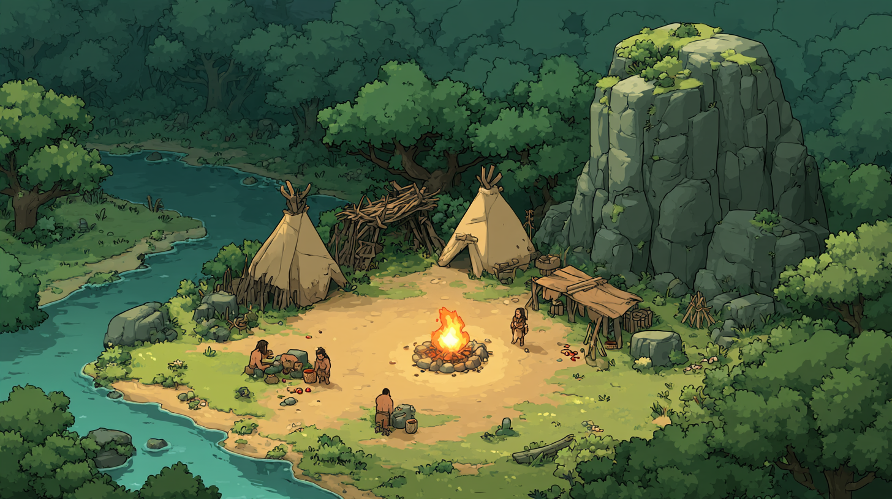

# 07 — Style Bible

*Version 0.1 — 5 November 2026. Official reference: `content/art/references/style-ref-01.png`.*

This document fixes the visual identity of Soul Invasion. Any new image must sit next to the reference without clashing.

## The reference

Midjourney link (for `--sref`):
`https://cdn.midjourney.com/0fb23b62-fb63-43e8-8f0d-ccb4fdcf6751/0_3.png`

The note beside the image (`style-ref-01.md`) records its prompt and date, as every validated image must.

## Identity in one sentence

**A world that is warm at the center and threatening at the edges**: a bold comic-book line, frank colors, and light that stages theatrical scenes where everything that matters reads at a glance.

## The rules

### Line
- **Thick, dark outlines** (brown-black, never pure black) on every element.
- **Simple, readable shapes**, slightly rounded. We simplify rather than detail.
- Shading in **flat, hard-edged areas**, two or three values at most. No photorealistic gradients.

### Palette
| Role | Colors |
|---|---|
| Forest (frame) | Deep, almost dark greens |
| Nearby vegetation | Fresh, luminous greens |
| Inhabited ground | Golden sand, ochre |
| Water | Vivid turquoise, lighter at the edge |
| Stone | Grey-green, acid-green moss on top |
| Wood, hides | Warm browns, cream beige |
| **Accent** | **Orange-yellow of fire**, reserved for points of attention |

- The brightest color on screen must always be an **important element** (fire, danger, rare item).
- Characters are **darker than the ground** they walk on.

### Light
- Warm, late-afternoon light.
- Living areas are **lit**, edges are **in shadow**. Light guides the eye to the action.
- Night must keep this principle: the fire becomes the only real light source.

### Camera
- **High-angle three-quarter view**, a single angle for every element.
- No strong perspective: an object must look the same wherever it is on screen.
- The world is drawn in **2D isometric** (D02): the ground on a 2:1 diamond grid of one-metre cells, the elements as flat images standing on it. The format every image must obey is in `09-visual-production.md`.

### Characters and animals
- Silhouettes **recognizable as shadow puppets**.
- Slightly stylized proportions (somewhat large head, stocky body).
- **Always more contrasted than the scenery**: dark clothing, hair or fur, well-marked outline.
- Dangerous animals (wolves) differ from peaceful ones (deer) by silhouette and posture, not only by color.

### Mood
- Warm, inhabited, handcrafted.
- A **threat always suggested**: dark forest, corners, tree lines. The world is beautiful but not safe.
- Dark themes (combat, theft, death) suggested, never graphic.

## What we avoid
- Photorealism, detailed textures, shiny reflections.
- Pastel or neon colors.
- Characters that blend into the ground.
- Varying camera angles.
- Elements overloaded with details that hurt readability.

## Production method
1. **Always** use `--sref` with the reference image.
2. Generate each element **isolated on a plain background** so it can be cut out.
3. Keep the validated images in `content/art/`, each with a note giving its exact prompt and date.
4. Once enough images are validated (about twenty), consider training a model on this style.
5. The AI draws, but does **not** handle animation: characters and animals will be animated as cut-out puppets in Godot.
6. Grounds are generated **seen from above and seamless**; the engine projects them onto the grid and blends them, so no diamond tile has to come out of the AI.
